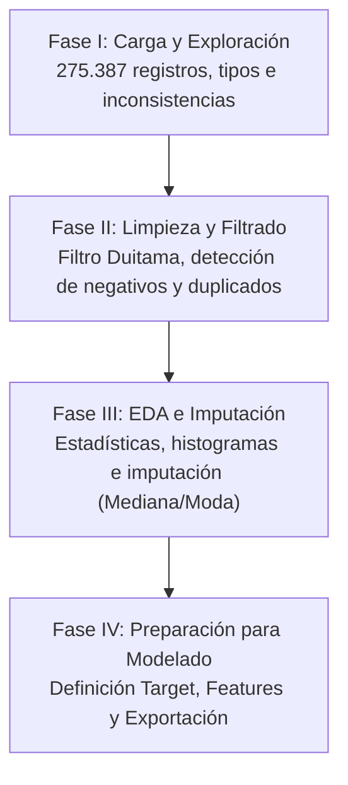

# Taller II: Preparación de Datos para Modelos de Predicción de Consumo Energético

[](https://www.python.org/)
[]()
[](https://www.uptc.edu.co/)

**Especialización en Inteligencia Artificial**  
**Universidad Pedagógica y Tecnológica de Colombia (UPTC)**  
**Asignatura / Módulo:** Ciencia de Datos e Inteligencia Artificial

---

## 1. Contexto del Problema

La Universidad Pedagógica y Tecnológica de Colombia (UPTC) monitorea el consumo de recursos en cuatro de sus sedes principales en el departamento de Boyacá:

* **Sede Tunja:** ~18.000 estudiantes
* **Sede Duitama:** ~5.500 estudiantes
* **Sede Sogamoso:** ~6.000 estudiantes
* **Sede Chiquinquirá:** ~2.000 estudiantes

El comportamiento energético varía considerablemente según la infraestructura, el calendario lectivo y las dependencias institucionales: **Comedores, Salones, Laboratorios, Auditorios y Oficinas**.

El propósito de este proyecto es implementar un pipeline integral de limpieza, preparación, imputación y estructuración de los registros históricos de consumo energético en la sede **Duitama**, dejándolos listos para el entrenamiento de modelos predictivos de Machine Learning.

---

## 2. Fases Metodológicas

El flujo de trabajo sigue las 4 fases y 21 pasos especificados en la guía de la asignatura:



1. **Fase I. Carga y Exploración Inicial:**
   - Carga del conjunto de datos `consumos_uptc.csv` (275.387 registros y 26 columnas).
   - Identificación de tipos de datos y análisis de frecuencias por sede.
   - Detección de inconsistencias categóricas (p. ej., variaciones ortográficas en `periodo_academico`).

2. **Fase II. Limpieza y Preparación Inicial:**
   - Detección de valores nulos globales.
   - Filtrado enfocado exclusivamente en la sede **DUITAMA** (68.862 registros iniciales).
   - Detección y eliminación de registros inválidos con consumos o emisiones físicas negativas (143 registros con `co2_kg < 0`).
   - Verificación y descarte de registros duplicados.

3. **Fase III. Análisis Exploratorio de Datos (EDA):**
   - Estadísticas descriptivas de los sectores energéticos (comedor, salones, laboratorios, auditorios, oficinas).
   - Visualización de histogramas de frecuencias y densidades (KDE).
   - Imputación robusta: **mediana** para variables numéricas continuas y **moda** para categóricas.
   - Cálculo e interpretación de la matriz de correlación (relación con ocupación, temperatura y potencia).

4. **Fase IV. Preparación para Modelado:**
   - Definición de la variable objetivo: `energia_total_kwh`.
   - Selección de variables predictoras (*features*) espaciotemporales y sectoriales.
   - Exclusión de identificadores únicos y redundantes (`reading_id`, `sede`, `sede_id`, etc.).
   - Construcción y exportación del dataset limpio listo para entrenamiento en `data/consumos_duitama_preparado.csv`.

---

## 3. Estructura del Proyecto

```text
clase3/
│
├── consumos_uptc.csv                    # Dataset original histórico UPTC
├── Taller II. Especialización en IA.pdf # Documento original del taller
├── instrucciones.md                    # Guía detallada de requerimientos y pasos
├── requirements.txt                    # Dependencias de Python
├── README.md                           # Documentación general del repositorio
├── .gitignore                          # Exclusiones de Git
│
├── notebooks/
│   └── taller_preparacion_datos.ipynb  # Cuaderno Jupyter con las 4 fases desarrolladas
│
├── src/
│   └── preparacion_datos.py            # Pipeline modular ejecutable desde consola
│
├── data/
│   └── consumos_duitama_preparado.csv  # Dataset final procesado (generado)
│
└── scripts/
    └── create_notebook.py              # Script utilitario de generación del notebook
```

---

## 4. Instalación y Uso

### Prerrequisitos
* Python 3.10 o superior instalado.

### Configuración del Entorno Virtual

1. Crear el entorno virtual:
   ```bash
   python -m venv venv
   ```
2. Activar el entorno virtual:
   * **Windows (PowerShell):**
     ```powershell
     .\venv\Scripts\Activate.ps1
     ```
   * **Linux / macOS:**
     ```bash
     source venv/bin/activate
     ```
3. Instalar librerías requeridas:
   ```bash
   pip install -r requirements.txt
   ```

### Ejecución del Pipeline por Consola

Para procesar el conjunto de datos directamente:

```bash
python src/preparacion_datos.py
```

### Ejecución en Jupyter Notebook o Google Colab

Para interactuar con los gráficos y el análisis exploratorio:

```bash
jupyter notebook notebooks/taller_preparacion_datos.ipynb
```

También puedes subir el archivo `.ipynb` y el archivo `consumos_uptc.csv` a **Google Colab** para trabajar en la nube.

---

## 5. Resultados del Procesamiento Inicial

* **Total de registros analizados:** 275.387 filas
* **Sede Duitama:** 68.862 registros (25,01% del dataset total)
* **Registros descartados por inconsistencia física:** 155 filas (valores negativos en CO2 y energía total)
* **Registros limpios finales:** 68.707 registros
* **Dataset generado:** 18 variables (17 características predictoras + 1 variable objetivo `energia_total_kwh`)

---

## 6. Autores y Licencia

Desarrollado como parte de las actividades prácticas de la Especialización en Inteligencia Artificial de la UPTC.
